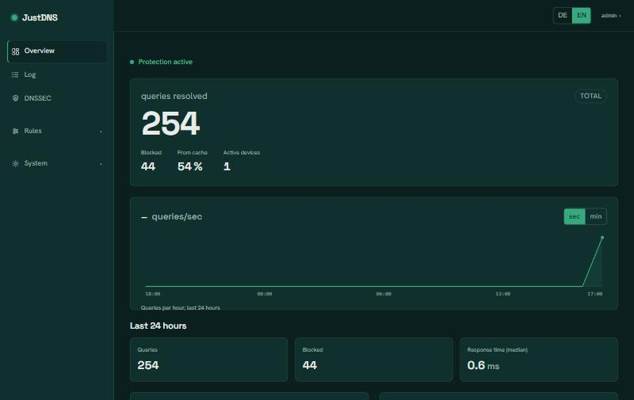
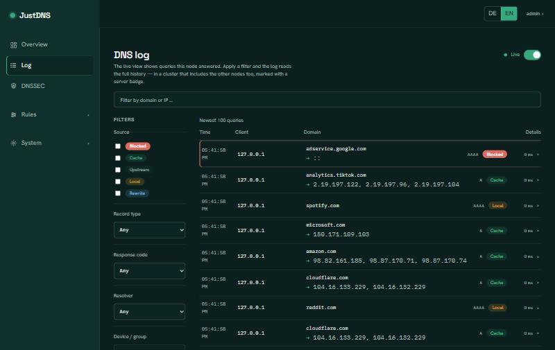
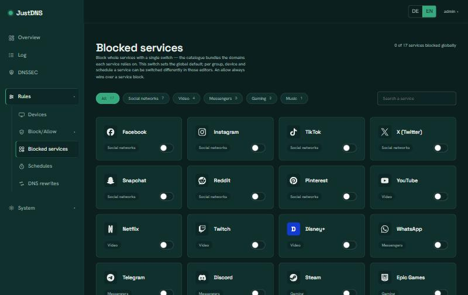
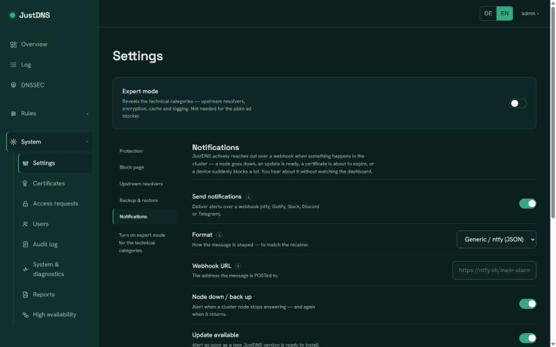

# JustDNS

**Das DNS deines ganzen Netzwerks — gefiltert, verschlüsselt und selbst gehostet.**

[](https://github.com/bonderaustriaAT/JustDNS/releases)
[](https://github.com/bonderaustriaAT/JustDNS/actions/workflows/image.yml)
[](https://github.com/bonderaustriaAT/JustDNS/pkgs/container/justdns)
[](LICENSE)
[](https://www.rust-lang.org)

*Auf Englisch lesen: [README.md](README.md).*

JustDNS ist ein filternder DNS-Forwarder, den du selbst betreibst. Richte deinen
Router oder deine Geräte darauf aus, und jede Namensauflösung läuft durch eine
Stelle: Werbung, Tracker und Schad-Domains werden blockiert, den Rest
beantworten deine gewählten Resolver über eine verschlüsselte Verbindung, und ein
aufgeräumtes Web-Dashboard zeigt dir genau, was in deinem Netz passiert — ohne
fremde Konten, ohne Cloud, und ohne dass Daten deine Maschine verlassen.

> Status: aktiv in Entwicklung, vor 1.0. Es läuft und ist schon nützlich;
> Einstellungen und Details können sich zwischen Versionen noch ändern.

<p align="center">
  
</p>

## Highlights

- **Blockt Werbung, Tracker und Schadsoftware** von Haus aus, mit kuratierten
  [Hagezi](https://github.com/hagezi/dns-blocklists)-Listen. Schalte die
  eingebauten Kategorien an oder aus, ergänze jederzeit eigene Allow-/Block-
  Einträge oder Listen-Abos und gib jedem **Gerät oder jeder Gruppe** eigene
  Regeln obendrauf.
- **Privat von Anfang an.** Standardmäßig datenschutzfreundliche EU-Resolver
  (DNS4EU, Quad9) über **DNS-over-TLS**, um die Wette abgefragt. Nutze eigene
  Resolver — Klartext, DoT oder DoH — oder wähle ein Profil **Privatsphäre /
  Ausgewogen / Tempo**.
- **Schnell.** Ein Antwort-Cache mit Vorab-Erneuerung und Serve-Stale sowie warme
  verschlüsselte Verbindungen halten wiederholte Abfragen nahezu sofort.
- **Lokale Rewrites.** Eigene Namen aus festen Adressen beantworten (A / AAAA) —
  praktisch für ein NAS, eine Homelab-Kiste oder Split-Horizon.
- **Safe Search.** Google, YouTube, Bing und DuckDuckGo netzweit auf ihre
  gefilterten Endpunkte zwingen.
- **Alles im Blick.** Ein Live-Dashboard und ein durchsuchbares Anfrage-Protokoll
  (was gefragt wurde, von welchem Gerät, wie es beantwortet wurde und worauf es
  auflöste).
- **Richtlinien pro Gerät & Gruppe.** Gib einem einzelnen Gerät oder einer ganzen
  Gruppe eigene Sperrlisten und Erlauben/Sperren-Regeln. Die Regeln stapeln sich —
  globale Vorgabe → Gruppe → Gerät — du stellst also nur ein, was abweicht.
- **Geführte Einrichtung.** Ein Assistent beim ersten Start führt durch
  Administratorkonto, Resolver und Aufbewahrung. Oberfläche auf **Deutsch und
  Englisch**.

## Ein Blick hinein

<table>
  <tr>
    <td width="33%" valign="top">
      <br>
      <sub><b>Protokoll</b> — jede Anfrage, welches Gerät fragte und wie beantwortet wurde, mit Live-Filtern.</sub>
    </td>
    <td width="33%" valign="top">
      <br>
      <sub><b>Blockierte Dienste</b> — ganze Dienste (TikTok, YouTube, …) global oder pro Gerät abschalten.</sub>
    </td>
    <td width="33%" valign="top">
      <br>
      <sub><b>Benachrichtigungen</b> — Webhook-Alerts bei Node-Ausfall, Update, ablaufendem Zertifikat oder Geräte-Spike.</sub>
    </td>
  </tr>
</table>

## Schnellstart (Docker)

Empfohlen ist das Zwei-Container-Bundle in [`deploy/`](deploy): der **Resolver +
Web-UI** plus ein kleines **Updater-Sidecar**, das One-Click-Updates aus dem
Dashboard ermöglicht. Der Hauptprozess fasst den Docker-Socket nie an — nur das
Sidecar —, damit das Updaten sicher bleibt. Beide Images kommen aus der öffentlichen
GitHub Container Registry, es ist also nichts zu bauen.

Aus einem Checkout dieses Repositorys:

```bash
cd deploy
cp .env.example .env     # optional: Version festnageln, Metrics-Token setzen
docker compose up -d
```

Kein Checkout? Hol dir die zwei Dateien direkt von GitHub und starte sie irgendwo:

```bash
mkdir justdns && cd justdns
curl -fsSL https://raw.githubusercontent.com/bonderaustriaAT/JustDNS/main/deploy/docker-compose.yml -o docker-compose.yml
curl -fsSL https://raw.githubusercontent.com/bonderaustriaAT/JustDNS/main/deploy/.env.example -o .env
docker compose up -d
```

Dann **http://<dein-host>:8080** öffnen — der Einrichtungs-Assistent übernimmt ab
hier. Richte das DNS eines Geräts (oder deines Routers) auf die IP des Hosts, um
loszulegen.

Der Zustand — Protokoll, Konfiguration, Konto, Listen und Caches — liegt im Volume
`justdns-data` und übersteht Neustarts und Updates. Ab hier ist Updaten ein Klick auf
der *System*-Seite des Dashboards — siehe [JustDNS aktualisieren](docs/guides/updates.de.md).

> **Einzelner Container (ohne In-App-Updates).** Wenn du nur den Resolver willst und
> selbst aktualisierst, kannst du nur das eine Image starten — dann ist das
> One-Click-Update aber nicht verfügbar, weil es das Sidecar braucht:
>
> ```bash
> docker run -d --name justdns -p 53:53/udp -p 53:53/tcp -p 8080:8080/tcp -v justdns-data:/data ghcr.io/bonderaustriaat/justdns:latest
> ```

## Konfiguration

Nach der Einrichtung ist alles über die Weboberfläche konfigurierbar. Einiges
wird beim Start über Umgebungsvariablen gesetzt:

| Variable | Standard | Wirkung |
|---|---|---|
| `JUSTDNS_LISTEN` | `0.0.0.0:53` | Adresse/Port, auf dem der DNS-Server lauscht |
| `JUSTDNS_WEB_LISTEN` | `0.0.0.0:8080` | Adresse/Port für Weboberfläche und API |
| `JUSTDNS_IPV6` | `false` | AAAA-Anfragen (IPv6) beantworten |
| `JUSTDNS_CACHE_CAPACITY` | `10000` | Maximale Anzahl zwischengespeicherter Antworten |
| `JUSTDNS_UPSTREAMS` | *(EU-Standard)* | Kommagetrennte Klartext-Resolver (`ip` oder `ip:port`) statt der mitgelieferten — praktisch, um auf einen lokalen Resolver zu zeigen |

Der dauerhafte Zustand liegt im Image standardmäßig unter `/data` (Datenbank,
`config.json`, Konto und Listen). Einmal gesetzt, ist die Konfigurationsdatei die
maßgebliche Quelle — die Umgebung befüllt nur den ersten Start.

## Aus dem Quellcode bauen

Benötigt eine Rust-Toolchain (Edition 2024, rustc ≥ 1.85) und Node.js für die
Weboberfläche. Die UI wird zuerst gebaut und in die Binärdatei eingebettet:

```bash
npm --prefix crates/justdns-web/ui ci
npm --prefix crates/justdns-web/ui run build
cargo build --release --bin justdns
```

Die Release-Binärdatei ist eigenständig (TLS-Wurzelzertifikate sind einkompiliert).
Oder nutze einfach das `Dockerfile`, das beide Schritte für dich erledigt.

## Wie es funktioniert

Jede Anfrage läuft durch eine einzige Pipeline: Zuerst gewinnt ein lokaler
**Rewrite**, dann die **Block**-Prüfung (ein gesperrter Name wird vor jeder
Auflösung abgelehnt), dann der **Cache** und schließlich die **Upstream**-Resolver
über die gewählte Übertragungsart. Jede behandelte Anfrage wird in einem lokalen
DuckDB-Protokoll festgehalten, das das Dashboard speist — und die Maschine nie
verlässt.

## Anleitungen

Schritt-für-Schritt-Anleitungen zu jedem Feature, in Klartext (Deutsch und
Englisch), liegen im **[Handbuch](docs/README.de.md)** ([English](docs/README.md)).
Neu bei JustDNS? Starte mit der [Ersteinrichtung](docs/guides/setup.de.md), dann
[die Übersicht](docs/guides/overview.de.md).

## Fahrplan & Änderungsverlauf

- Wohin sich JustDNS entwickelt: [ROADMAP.de.md](ROADMAP.de.md)
  ([English](ROADMAP.md)).
- Was in jeder Version neu ist: [CHANGELOG.de.md](CHANGELOG.de.md)
  ([English](CHANGELOG.md)).

## Lizenz

[AGPL-3.0-or-later](LICENSE). Beiträge werden unter derselben Lizenz angenommen;
siehe [CONTRIBUTING.md](CONTRIBUTING.md).
